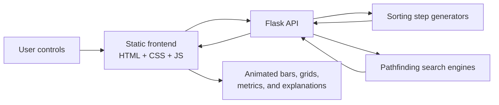

<div align="center">

# The Algorithm Laboratory and Comparative Simulation Suite

**An interactive full-stack playground for watching algorithms think.**

## Recent Updates

- **Phase D — Tries, Hashing, and Merkle Trees**: three new laboratory units. The trie page shows prefix sharing with created-vs-reused nodes and live autocomplete previews; the hashing page runs separate chaining and open addressing side by side on the same keys, with load-factor meters, tombstones, and resize replays; the Merkle page builds a real SHA-256 tree and animates tamper propagation. Each unit ships three lessons, a ten-question quiz, glossary entries, and hub/Guided Path registration.
- **Learn Mode, Quizzes, and Progress**: every live unit now has Learn Mode with checkpoints, glossary term tooltips, and an end-of-lesson quiz. Best scores persist locally behind an 80% pass mark and surface as hub badges and Guided Path state.
- **Font Improvements**: Switched the body font to **Inter** for a clean, professional look and set numeric displays to **Roboto Mono** for better readability. The title font remains unchanged.
- **Navigation Icon Fixes**: Restored missing SVG logos on the BST & Trees page. Added correct icons for Sorting, Pathfinding, BST & Trees, and Definitions. The Pathfinding button now uses the proper compass/locator icon, matching the home page.


Compare sorting algorithms side by side, explore shortest-path search on an editable grid, watch BST, heap, AVL, trie, hash, and Merkle structures evolve, and learn the vocabulary behind the visuals through a searchable glossary.


<br>

[`Sorting Duel`](#sorting-duel) |
[`Pathfinding Lab`](#pathfinding-lab) |
[`Glossary`](#glossary-and-definitions) |
[`API`](#api-reference) |
[`Setup`](#quick-start)

</div>

---

## What Is This?

The Algorithm Laboratory is an educational visualization suite built for students, teachers, and curious developers who want to see classic algorithms move instead of only reading pseudocode.

The project uses a **Python Flask backend** to generate authoritative algorithm execution data and a **lightweight HTML/CSS/JavaScript frontend** to render those steps as animations. There is no frontend build system, no heavyweight framework, and no mystery layer between the algorithm and what appears on screen.



## Why It Stands Out

| Experience | What It Does | Why It Matters |
| --- | --- | --- |
| **Sorting Duel** | Runs two sorting algorithms on the same input array | Makes performance differences visible, not abstract |
| **Pathfinding Lab** | Animates graph search over an editable grid | Shows how search strategies expand, hesitate, and commit |
| **Glossary and Definitions** | Explains core algorithm terms in searchable cards | Connects visuals to the language used in DSA classes |
| **Backend-generated steps** | Produces execution traces in Python | Keeps animation logic consistent and testable |
| **No Node required** | Frontend runs as static files | Simple setup for classrooms, demos, and college projects |

## Feature Snapshot

- Side-by-side sorting races on identical randomized data
- Start, pause, reset, speed, and element-count controls
- Comparison counters and backend logic-time measurements
- Interactive pathfinding grid with movable start and target nodes
- Wall drawing, path clearing, full grid reset, and maze presets
- Dijkstra, A*, and Bellman-Ford/SPFA-style pathfinding modes
- Dynamic algorithm information cards with complexity notes
- BST, heap, AVL, trie, hash-table, and Merkle-tree visualizers
- Side-by-side chaining vs open-addressing hash tables on identical key sequences
- Searchable glossary for algorithm vocabulary
- Inline glossary tooltips in lesson narration, with deep links into the glossary page
- Lesson-driven walkthroughs with checkpoints for every live unit
- Ten-question quizzes with a topic breakdown, missed-answer review, and retakes
- Optional local progress (best score per unit, 80% pass mark) and hub badges
- Guided Path order with a dismissible, non-blocking quiz nudge
- Flask JSON API with validation

## Sorting Duel

The sorting lab gives each algorithm its own arena while keeping the input identical. That means Bubble Sort, Quick Sort, Merge Sort, Heap Sort, Bogo Sort, and the rest are not just displayed; they are compared under the same conditions.

| Algorithm | ID | Family | Visualization Notes |
| --- | --- | --- | --- |
| Bubble Sort | `bubble` | Brute Force | Adjacent comparisons and swaps |
| Selection Sort | `selection` | Brute Force | Full scans with targeted minimum placement |
| Insertion Sort | `insertion` | Decrease and Conquer | Growing sorted prefix |
| Quick Sort | `quick` | Divide and Conquer | Pivot-based partition movement |
| Merge Sort | `merge` | Divide and Conquer | Recursive split and merge behavior |
| Heap Sort | `heap` | Selection Method | Heap construction and extraction |
| Bogo Sort | `bogo` | Randomized Brute Force | Chaotic shuffles with a safety cap |
| Optimized Bogo Sort | `optbogo` | Randomized Decrease | Shuffles only the unresolved region |
| Counting Sort | `counting` | Distribution Sort | Count-based placement, no pairwise sorting |
| Radix Sort | `radix` | Distribution Sort | Digit-by-digit stable passes |

The backend returns a sequence of `compare` and `swap` steps. The frontend uses those steps to animate bars, update counters, and display the final sorted state.

## Pathfinding Lab

The pathfinding page turns a grid into a searchable graph. Users can draw walls, drag the start and target nodes, generate maze patterns, and watch each algorithm decide where to search next.

| Algorithm | ID | Search Style | Current Grid Behavior |
| --- | --- | --- | --- |
| Dijkstra's Algorithm | `dijkstra` | Uniform-cost shortest path | Expands outward by cheapest known distance |
| A* Search | `astar` | Heuristic-guided shortest path | Uses Manhattan-style direction toward the target |
| Bellman-Ford/SPFA Variant | `bellmanford` | Queue-based relaxation | Revisits improved paths using a queue approach |

The current grid uses **uniform movement cost**. Weighted terrain is not implemented yet, which keeps the visualization focused on the search pattern rather than cost modeling.

## Glossary And Definitions

The glossary page is a searchable companion to the labs. It explains the terms students repeatedly meet while studying algorithms, including:

- Big O notation
- auxiliary space
- stable sort
- pivot
- partition
- time complexity
- relaxation
- heuristic
- priority queue

The glossary is the single source for 110 terms (`frontend/js/shell/glossaryData.js`), including trie, hashing, and Merkle vocabulary. Lessons reuse it: narration and checkpoint text can mark a term with `{{term:Height|height}}`, which renders an inline `?` button and a keyboard-operable popover with the plain-text definition and an “Open in glossary” link. Glossary cards are focusable, and `definitions.html#term-<slug>` opens and highlights a specific term.

## Binary Trees & BSTs

This module provides interactive visualization for hierarchical data structures. Users can toggle between two separate visualizer environments:

- **BST Mode**: Inserts unique values sequentially into a Binary Search Tree (with trace animations for node inserts, tree traversals, BST deletions, and step-by-step Learn Mode playback).
- **Play Mode**: Interactive controls for inserting, deleting, and traversing nodes with speed adjustment, pause, and clear functionality, allowing users to experiment with BST operations in real time.
- **Learn Mode**: Step-by-step guided insertion and deletion tutorials with checkpoints, narration, and Prev/Next/Reset controls. Finishing a lesson offers its quiz without leaving the panel.
- **Quiz and progress**: A ten-question BST quiz runs from the end of a lesson or from “Test yourself” on the hub (`bst.html?quiz=bstQuiz`). Results show a topic breakdown and every missed answer. Best scores are stored locally (80% passes); the hub shows a text-and-icon badge and the Guided Path marks the unit passed. Nothing is sent to the backend, and the app still works when storage is blocked.
- **General Binary Tree Mode**: Maps arrays directly into binary trees using the $2i+1$ indexing rule, supporting gaps and `null` values dynamically.
- **Interactive Node Inspector**: Click on any tree node inside the SVG canvas to view its live statistics (calculated Height and Depth) generated directly by the Flask API.
- **Live Classification badges**: Evaluates whether the current tree structure is Full, Complete, Perfect, or Balanced, showing violation warnings if any properties are broken.

## Heaps And Heapsort

The heap lab shows the array and the complete tree at the same time, driven by one playback timeline. Insert bubbles up, extract bubbles down, build heapifies bottom-up, and heapsort marks the shrinking heap boundary with a `heap | sorted` divider. Every cell carries a 0-based index, and the "Index formulas" panel spells out `2i+1`, `2i+2`, and `(i-1)//2`.

- Min-heap and max-heap toggle, multi-value insert, extract, build, and heapsort in both directions
- Learn Mode lessons for insertion, build + extract, and heapsort
- Ten-question `heapQuiz`

## AVL Trees

The AVL lab animates all four rotation cases with node identity preserved across the rotation. Balance factors are never stored: every snapshot recomputes them from the links, and the badge gains a trailing `!` plus a dashed ring when a node leaves −1…+1. The "Compare with plain BST" toggle replays the same inserts into both trees so the height difference is visible.

- LL, RR, single-phase LR/RL, cascade demos, and delete-with-rebalancing
- Learn Mode lessons for LL/RR, LR/RL, and cascading rotations
- Ten-question `avlQuiz`
- Learn-mode comparison advances one action at a time with the lesson

## Tries

The trie lab stores characters on edges, so shared prefixes share nodes. Inserting `card` after `car` creates only the `d` node and reuses the rest. Terminal nodes get a double ring, created nodes render green and reused nodes blue, and a live prefix preview lists completions without changing the stored words.

- Insert, search, and prefix modes on a single `/trie` endpoint
- Debounced 200 ms autocomplete preview, guarded against stale responses; clicking a suggestion fills the Search box
- Lowercase normalization, duplicate rejection, and explicit node/step caps
- Three lessons (`trieLessons.js`) and a ten-question `trieQuiz`

## Hashing

The hashing lab runs separate chaining and open addressing side by side on the identical key sequence. Each step shows the per-character hash computation, so the index is explainable rather than magic. `sum_mod` is deliberately weak and clusters anagrams; `poly` spreads keys better. The load-factor meters and counters make the trade-off visible.

- Chaining (`chain_append`) and linear probing (`probe`, `place`) traces in one response
- Visible tombstones (`†`) on delete, cleared by a rehash
- Automatic resize at 0.75 (open) and 1.0 (chaining), with per-key moves replayed
- Presets: anagram collision demo and fill-to-trigger-resize
- Three lessons (`hashLessons.js`) and a ten-question `hashQuiz`

## Merkle Trees

The Merkle lab builds a real SHA-256 tree from editable blocks. Leaves hash the block text and each parent hashes its two children, so the root commits to every block. Tampering with one block recomputes only the path to the root, and the banner reports whether the root changed and how many internal hashes were recomputed.

- Real `hashlib` SHA-256; eight hex characters on the canvas, full 64-character digest in the node inspector
- Duplicate-last policy for odd levels, with duplicate nodes shown as their own labelled node
- Per-row Tamper, a Build that commits every editor value, and an editor that locks while a trace plays
- Three lessons (`merkleLessons.js`) and a ten-question `merkleQuiz`

## Project Structure

```text
The Algorithm Laboratory and Comparative Simulation Suite/
|-- backend/
|   |-- algs.py              # Sorting step generators
|   |-- app.py               # Flask API routes and error handling
|   |-- hashing.py           # Chaining + open-addressing hash table traces
|   |-- merkle.py            # SHA-256 Merkle build/tamper traces
|   |-- pathfinding.py       # Dijkstra, A*, and Bellman-Ford/SPFA logic
|   |-- tracing.py           # make_step and DEFAULT_ROLES tracing support
|   |-- trees.py             # BST, heap, and AVL step engines and calculators
|   |-- tries.py             # Trie insert/search/prefix traces
|   |-- validation.py        # Centralized payload validators
|   `-- tests/               # Pytest suite (360 tests)
|-- frontend/
|   |-- index.html           # Hub: unit cards and shared navigation
|   |-- sorting.html         # Sorting Duel page
|   |-- pathfinding.html     # Pathfinding visualizer page
|   |-- bst.html             # Binary Trees & BSTs page
|   |-- heaps.html           # Heaps & Heapsort page
|   |-- avl.html             # AVL Trees page
|   |-- trie.html            # Tries page
|   |-- hashing.html         # Hashing page (chaining vs open addressing)
|   |-- merkle.html          # Merkle Trees page
|   |-- definitions.html     # Glossary page
|   |-- test.html            # Primitives verification harness
|   |-- css/
|   |   |-- style.css
|   |   |-- hub.css           # Hub card grid, Guided Path, progress badges
|   |   |-- primitives.css
|   |   |-- lab.css           # Shared side panel, mode tabs, metric boxes
|   |   |-- quiz.css          # Quiz engine and results
|   |   |-- glossary.css      # Inline term markers/popover, glossary page focus
|   |   `-- definitions.css
|   `-- js/
|       |-- shell/
|       |   |-- units.js      # Unit registry (single source of truth)
|       |   |-- nav.js        # Shared Primary navigation
|       |   |-- hub.js        # Hub cards, badges, Guided Path nudge
|       |   |-- progress.js   # localStorage progress with safe fallback
|       |   |-- glossaryData.js    # Glossary source of truth (110 terms)
|       |   |-- glossaryTooltip.js # Inline {{term:...}} markers + popover
|       |   `-- landing.js    # Splash screen + digit-sort transition
|       |-- engine/
|       |   |-- LessonRunner.js    # Generic lesson state machine
|       |   `-- PlaybackController.js
|       |-- lessons/
|       |   |-- bstLessons.js      # BST lesson data (insert + deletion)
|       |   |-- heapLessons.js     # Heap insert/build/heapsort lessons
|       |   |-- avlLessons.js      # LL/RR, LR/RL, cascade lessons
|       |   |-- trieLessons.js     # Trie lessons
|       |   |-- hashLessons.js     # Hashing lessons (with phase handover)
|       |   `-- merkleLessons.js   # Merkle lessons
|       |-- quizzes/
|       |   |-- index.js           # Quiz registry
|       |   |-- bstQuiz.js
|       |   |-- heapQuiz.js
|       |   |-- avlQuiz.js
|       |   |-- trieQuiz.js
|       |   |-- hashQuiz.js
|       |   `-- merkleQuiz.js
|       |-- primitives/
|       |   |-- ArrayStrip.js  # Array-of-cells renderer (heaps)
|       |   |-- TreeCanvas.js  # Generic SVG tree renderer (n-ary opt-in)
|       |   |-- QuizEngine.js  # Generic quiz renderer
|       |   |-- BucketGrid.js  # Hash table / DP grid visualizer
|       |   |-- GrowthChart.js # Growth visualizer
|       |   `-- treeAdapter.js # Tree canvas adapter
|       |-- algorithmData.js
|       |-- api.js
|       |-- avl.js             # AVL page controller
|       |-- bst.js             # BST and Binary Tree page controller
|       |-- controls.js
|       |-- definitions.js
|       |-- hashing.js         # Hashing page controller
|       |-- heaps.js           # Heap page controller
|       |-- merkle.js          # Merkle page controller
|       |-- pathfinding.js
|       |-- pathfindingData.js
|       |-- renderer.js
|       |-- tries.js           # Trie page controller
|       `-- utils.js
|-- dev/
|   `-- validate_content.mjs # Dev-only lesson/quiz/glossary validator (39 checks)
|-- docs/
|   |-- LESSON_SPEC.md
|   |-- QUIZ_SPEC.md
|   `-- TRACE_SPEC.md         # One trace contract for every unit
|-- install_dependencies.bat
|-- README.md
`-- .gitignore
```

## Tech Stack

| Layer | Tools |
| --- | --- |
| Backend | Python, Flask, Flask-CORS |
| Algorithms | Pure Python step generators |
| Frontend | HTML, CSS, vanilla JavaScript |
| Setup | Windows batch installer plus manual virtual environment option |

## Quick Start

### One-click local launch

After installing dependencies once, double-click:

```text
start_app.bat
```

This starts the Flask server and opens the app at:

```text
http://127.0.0.1:5000
```

Close the command window to stop the app.

### 1. Install dependencies

The simplest Windows setup path is:

```bat
install_dependencies.bat
```

That script creates a virtual environment and installs:

- `flask`
- `flask-cors`

Manual setup also works:

```powershell
python -m venv venv
venv\Scripts\Activate.ps1
python -m pip install --upgrade pip
pip install flask flask-cors
```

If you are using Command Prompt:

```bat
venv\Scripts\activate.bat
```

### 2. Start the backend

From the project root:

```powershell
venv\Scripts\python backend\app.py
```

The web app and API run at:

```text
http://127.0.0.1:5000
```

From there, use the in-app navigation to move between:

- Sorting Duel
- Pathfinding
- BST & Trees
- Heaps & Heapsort
- AVL Trees
- Tries
- Hashing
- Merkle Trees
- Definitions

## API Reference

### `POST /sort`

Generates animation steps for a sorting algorithm.

Request:

```json
{
  "algorithm": "quick",
  "array": [42, 7, 19, 3, 25]
}
```

Response:

```json
{
  "steps": [
    {
      "type": "compare",
      "indices": [0, 4],
      "current_state": [42, 7, 19, 3, 25]
    }
  ],
  "execution_time": 0.123
}
```

Supported algorithm IDs:

```text
bubble, selection, insertion, quick, merge, heap, bogo, optbogo, counting, radix
```

### `POST /pathfind`

Generates visited nodes and shortest-path output for a grid search.

Request:

```json
{
  "algorithm": "astar",
  "rows": 10,
  "cols": 10,
  "startNode": { "row": 0, "col": 0 },
  "endNode": { "row": 9, "col": 9 },
  "walls": [
    { "row": 1, "col": 2 },
    { "row": 2, "col": 2 }
  ]
}
```

Response:

```json
{
  "visited_nodes": [
    { "row": 0, "col": 0 },
    { "row": 0, "col": 1 }
  ],
  "path": [
    { "row": 0, "col": 0 },
    { "row": 0, "col": 1 },
    { "row": 1, "col": 1 }
  ]
}
```

Supported pathfinding IDs:

```text
dijkstra, astar, bellmanford
```

### `POST /tree`

Generates tree steps for BST and binary-tree algorithms (`bst_insert`, `bst_delete`, `bst_traverse`, `bst_classify`, `bst_height_depth`, `array_to_tree`, `bst_mirror`). Heap and AVL traces moved to their own `/heap` and `/avl` routes in Phase C.

Request:

```json
{
  "algorithm": "bst_traverse",
  "tree_type": "bst",
  "order": "inorder",
  "ops": [
    { "op": "insert", "value": 50 },
    { "op": "insert", "value": 30 }
  ]
}
```

Response:

```json
{
  "steps": [
    {
      "type": "visit",
      "annotation": "Visiting node 30 (Visit #1)",
      "highlighted": [1],
      "snapshot": {
        "nodes": [
          { "id": 0, "label": "50", "parent_id": null, "side": null },
          { "id": 1, "label": "30", "parent_id": 0, "side": "left" }
        ],
        "root_id": 0
      }
    }
  ],
  "final_tree": { "nodes": [], "root_id": 0 }
}
```

`ops` is the only accepted input shape for BST mode. The deprecated `values` alias was removed: sending `values` (or `values` inside a `bst_mirror` tree spec) returns `400` with `{"error": "...", "field": "values"}`. Use `{"op": "insert", "value": n}` entries instead.

### `POST /heap`, `POST /avl`

Both follow the same op-log contract as `/tree`: replay `ops[]` statelessly, append the requested action, and return `steps` + `final_*` + `metrics`.

```json
{
  "algorithm": "heap_insert",
  "heap_type": "min",
  "ops": [{ "op": "insert", "value": 5 }],
  "action": { "op": "insert", "value": 2 }
}
```

```json
{
  "algorithm": "avl_insert",
  "ops": [{ "op": "insert", "value": 10 }],
  "value": 20
}
```

`heapsort` takes `{"algorithm": "heapsort", "heap_type": "max", "array": [...]}` instead of an op log. Every step carries both an array and a tree snapshot.

### `POST /trie`

```json
{
  "algorithm": "trie_prefix",
  "ops": [
    { "op": "insert", "word": "car" },
    { "op": "insert", "word": "card" }
  ],
  "prefix": "ca"
}
```

`algorithm` is `trie_insert`, `trie_search`, or `trie_prefix`. `trie_insert` takes `word`; `trie_search` and `trie_prefix` take `word` / `prefix`. Returns `steps`, `final_tree`, `metrics` (node/word counts, created vs reused), and `metadata` (including `completions` for a prefix query). Words are lowercased; duplicates return `400`.

### `POST /hash`

```json
{
  "algorithm": "hash_insert",
  "hash_fn": "sum_mod",
  "table_size": 7,
  "probing": "linear",
  "ops": [{ "op": "insert", "key": "ab" }],
  "action": { "key": "ba" }
}
```

Runs separate chaining and open addressing over the same keys in one response. `hash_fn` is `sum_mod` or `poly`; `probing` is `linear`; `table_size` is 1-31. Returns `steps` (chaining steps first, each carrying both snapshots), `final_state` (`chaining` and `open`), `metrics`, and `metadata`. Deletes leave tombstones in the open table; resizes emit `resize_start` / `resize_move` / `resize_done`.

### `POST /merkle`

```json
{
  "algorithm": "merkle_tamper",
  "leaves": ["a", "b", "c", "d"],
  "index": 3,
  "new_data": "Z"
}
```

`merkle_build` takes only `leaves`; `merkle_tamper` adds `index` and `new_data`. Leaves are non-empty strings (capped count and length). Returns `steps`, `final_tree` (nodes carry `digest` and `duplicate_of`), `metrics` (nodes, leaves, levels, recomputed), and `metadata`. SHA-256 is computed with `hashlib`; the canvas shows eight hex characters and the inspector shows all 64.

All POST routes reject GET with a JSON `405 {"error", "field": "request"}` and invalid payloads with `400 {"error", "field"}`. No user-reachable path returns a 500.

## Educational Design

This project is built as a learning tool, not just a visual effect. The important design idea is that every animation should connect to a concept:

| Concept | How The Lab Shows It |
| --- | --- |
| Comparisons | Highlighted bar pairs during sorting |
| Swaps and writes | Animated state changes in the bar array |
| Runtime behavior | Side-by-side comparison and logic-time metrics |
| Search frontier | Visited grid nodes expanding over time |
| Shortest path | Reconstructed final route from start to target |
| Shared prefixes | Created vs reused trie nodes and terminal rings |
| Collisions | Chaining rows vs probe sequences on identical keys |
| Tamper detection | Merkle path recompute and a changed-root banner |
| Complexity language | Info cards and glossary definitions |

## Known Characteristics

- The sorting visualizer measures backend logic time separately from animation speed.
- Bogo-style algorithms are intentionally capped to prevent browser lockups.
- Counting Sort and Radix Sort only support non-negative integers in the backend.
- The pathfinding grid currently uses uniform-cost movement.
- Quiz attempts and progress stay in `localStorage`; they are never sent to the backend, and a blocked or full storage falls back to session memory.
- Tries lowercase every word, reject duplicates, and cap node/step counts; the autocomplete preview never mutates the stored words.
- Hashing supports linear probing only and resizes at 0.75 (open) and 1.0 (chaining), with an in-place rehash fallback at the table-size cap.
- Merkle trees use the duplicate-last policy for odd levels. Digests are real SHA-256, but the canvas truncates them to eight hex characters.
- The legacy `values` input for `POST /tree` has been removed in favour of `ops`.
- The frontend is optimized for local use and project demos rather than production deployment.

## Roadmap Ideas

- Weighted terrain for pathfinding
- More graph algorithms such as BFS, DFS, Greedy Best-First Search, and Floyd-Warshall
- More maze generators and obstacle presets
- Exportable experiment summaries
- Mobile layout polish for smaller screens
- A hosted demo build

## Author Notes

This repository is a strong fit for:

- DSA coursework
- algorithm visualization demos
- classroom explanations
- project presentations
- interview-prep experiments
- comparing textbook complexity with visual behavior

<div align="center">

**Built to make algorithms feel less like static notes and more like systems you can inspect, compare, and understand.**

</div>
